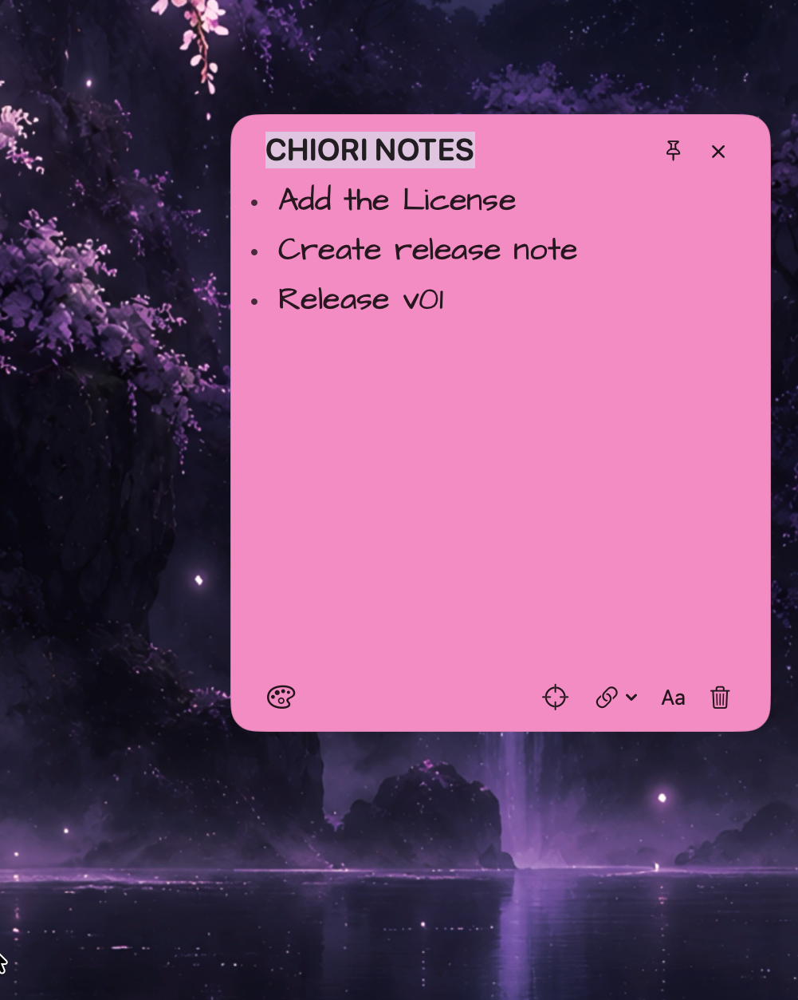
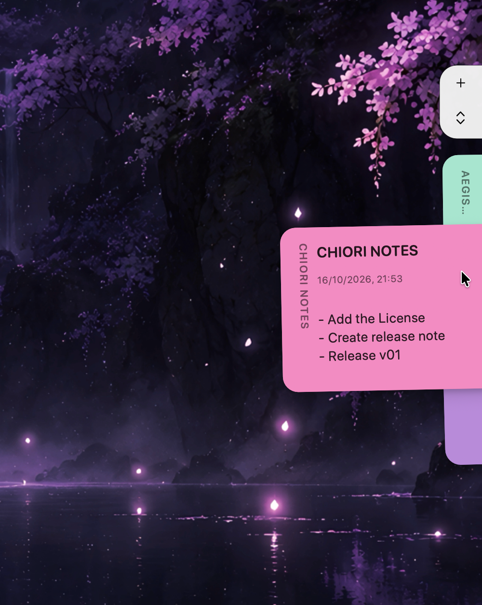

# SHIORI

SHIORI is a free, open-source macOS menu-bar app for sticky notes that stay close to your work. Keep notes at the screen edge, hover to preview them, or open them as floating windows. 
Write in Markdown with clickable checklists, choose a note color and font, and find notes with Quick Search. Attach notes to an app so they follow its active window, or use Focus to keep one note in view.

<p align="center">
  
  
</p>

## Install

Download **SHIORI.dmg** from [Releases](https://github.com/ITS-MSW/SHIORI/releases), open it and drag **SHIORI.app** onto **Applications**. Eject the image and open the app from Applications. Quit an older SHIORI before replacing it.

See [distribution and release instructions](docs/releases.md) for local packaging and the draft-release workflow.

The deployment target is macOS 14 or later; the app includes Apple silicon and Intel executables. You do not need Xcode to run the download. The build is ad-hoc signed and not notarized by Apple. If macOS blocks it, proceed only if you trust its source: after trying to open it, use **System Settings → Privacy & Security → Open Anyway** if available. See [Apple’s guidance](https://support.apple.com/en-ie/102445).

### Build from source

Requires Xcode with Swift 6.2 or later. The included project resolves pinned Swift packages automatically.

```sh
git clone https://github.com/ITS-MSW/SHIORI.git
cd SHIORI
xcodebuild -project SHIORI.xcodeproj -scheme SHIORI \
  -configuration Release -derivedDataPath build build
open build/Build/Products/Release/SHIORI.app
```

## Setup

SHIORI appears in the menu bar, with note tabs at your display edge. Hover over the tabs and click **+** to create a note. Use the pin, target and link controls for floating notes, Focus and app attachment.

For responsive app-window tracking, choose **Enable Responsive Window Tracking…** in the attachment menu and allow SHIORI in macOS Accessibility settings. Global shortcuts work without that permission:

- **Option+N:** new note
- **Option+Space:** Quick Search
- **Option+Shift+H:** hide/show floating notes

Change shortcuts, typography, Launch at Login and the optional Touch ID lock in Settings. Notes and backups stay in `~/Library/Application Support/app.shiori.desktop/`. Touch ID hides the interface; it does not encrypt these files. Deleted notes remain in the database. There is no permanent-delete, export or sync interface.

Intel and minimum-macOS compatibility, real Touch ID, Spaces and monitor transitions still need wider testing.

## Credits and license

Inspired by [Hold My Notes](https://holdmynotes.app/) by [Shobhit Bhosure](https://github.com/shobhit99).

SHIORI uses the [MIT License](LICENSE). Dependencies and fonts retain their own licenses; see [third-party notices](THIRD_PARTY_NOTICES.md).
